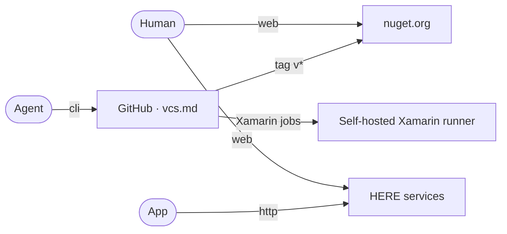

# Ecosystem

## Services

- GitHub holds code, pull requests, rulesets and actions. Agents reach it with `gh`.
- nuget.org receives packages through trusted publishing over GitHub OIDC. No long-lived nuget.org key exists anywhere.
- On the owner's plan, rulesets, environments and Pages exist only on public repositories. Extraction repositories stay private until `10.1`, so they apply none of them; task `1.12a` settles how they publish a prerelease.
- Publication procedure and its traps: `docs/runbooks/nuget-publication.md`.
- HERE services: credentials are managed on the HERE Developer Portal, in a web console only. No agent reaches it.
- HERE credentials reach CI through GitHub Actions secrets `HERE_ACCESS_KEY_ID`, `HERE_ACCESS_KEY_SECRET` and `HERE_API_KEY`. Locally they come from user secrets or environment variables.
- Never commit a credential. Packages hold none and read no environment variable. Integration tests skip when credentials are absent.
- Public web demonstrations use a separate HERE key, restricted to the Pages domain. Server-side demonstrations keep theirs off the browser.
- The self-hosted runner carries the frozen Xamarin column and nothing else, with a pinned Xcode. Modern iOS heads build on GitHub-hosted macOS images.
- A job verifies the runner's Xcode and fails if it moves. The Xamarin matrix is disjoint, so an unavailable runner never blocks other builds.
